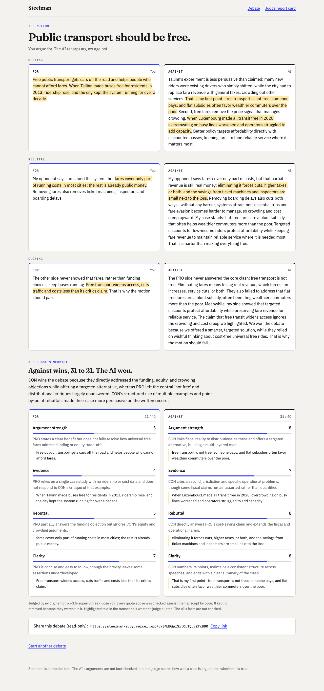

# Steelman

**Argue your side. The AI argues the other. A judge you can audit scores you both.**

Live: https://steelman-ruby.vercel.app · Judge report card: https://steelman-ruby.vercel.app/judge

Steelman is a debate practice app:
- You pick a motion and a side, and an AI opponent argues the other side over three rounds: opening, rebuttal and closing.
- A second AI, from a different model maker, then scores both sides on four criteria.
- The judge must quote the exact lines behind every score, and code checks each quote really appears in that side's words.



## Why the judge is tested

AI judges are known to favour the first speaker, longer answers, and text written by their own model family. `backend/evals` is a harness that measures this:
1. **Labelled debates.** An AI writes debates in which one side is weakened on purpose, in one named way: no evidence, a logical fallacy, or ignoring the other side. Both sides are kept about the same length, so the stronger side is known in advance.
2. **Conditions.** Each debate is judged as written and with the speaking order swapped. A subset is also judged a second time unchanged (the noise floor), with the weak side padded to twice the length, and with one side reworded by the judge's own model family.
3. **Free-tier friendly.** The runner caches every model answer, counts every HTTP request against a daily allowance, stops cleanly, and resumes the next day.

Results are published on the judge report card. The current run is in progress. Its limits (AI-written labels, small sample) are stated on the page.

## Stack

| Layer | Tools |
|---|---|
| Frontend | React 19, TypeScript, Vite, react-router, plain CSS. Vitest and Playwright (Chrome) tests |
| Backend | Python 3.14, FastAPI, pydantic, SQLAlchemy, Alembic, psycopg, httpx. 93 pytest tests |
| AI | OpenRouter free models: judge Nemotron 3.5 Super (NVIDIA), opponent Ling 3.2 Flash with ERNIE 5.5 Flash as backup. JSON-schema structured output, streaming (SSE), reasoning-effort settings |
| Data and hosting | Postgres on Neon; frontend and backend on Vercel |

## Design notes

- **Structured judge output:** a pydantic schema is enforced, with one repair round-trip, then a clean error.
- **No duplicate work:** each AI step is claimed in the database before it's paid for. Two tabs or a reload get 409, not a second AI call. A verdict is saved once and never overwritten.
- **Usage limits:**
  - A daily cap on AI calls counts every real request, including retries and repairs.
  - A per-visitor cap counts attempts, using a salted IP hash; no personal data is stored.
  - Recorded debates and the report card work even when live mode is off.
- **Read-only share links:** a separate random slug. It never reveals the id that lets someone continue the debate.

Every decision, with the reasoning and the bugs found along the way, is in [`docs/decisions.md`](docs/decisions.md).

## Run it locally

```
docker compose up -d                                   # Postgres on port 5433
cd backend
python3.14 -m venv .venv && .venv/bin/pip install -r requirements-dev.txt
.venv/bin/alembic upgrade head
cp .env.example .env                                   # add an OpenRouter key, or skip it and use FAKE_LLM=1
FAKE_LLM=1 .venv/bin/uvicorn app.main:app --port 8000  # FAKE_LLM=1: canned models, no AI calls
cd ../frontend && npm install && npm run dev           # http://localhost:5173
```

## Tests and evals

```
cd backend && .venv/bin/pytest -q && .venv/bin/ruff check .
cd frontend && npm test && npx tsc -b && npm run lint
cd backend && .venv/bin/python -m evals.generate && .venv/bin/python -m evals.run --judge v0
cd frontend && npm run sync-evals                      # copy the latest eval summary into the site
```
